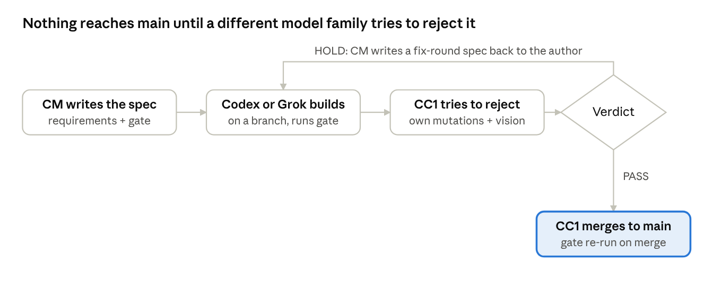
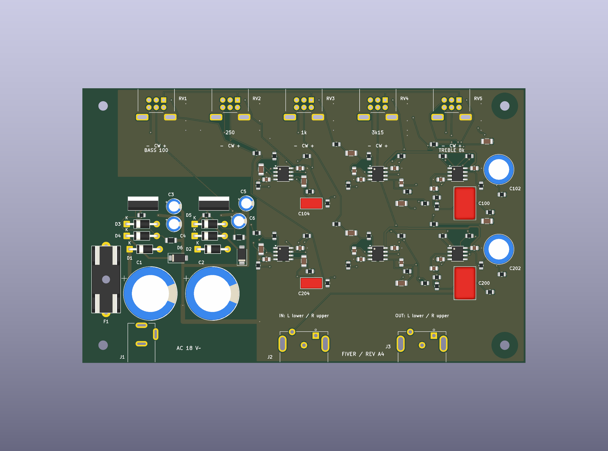
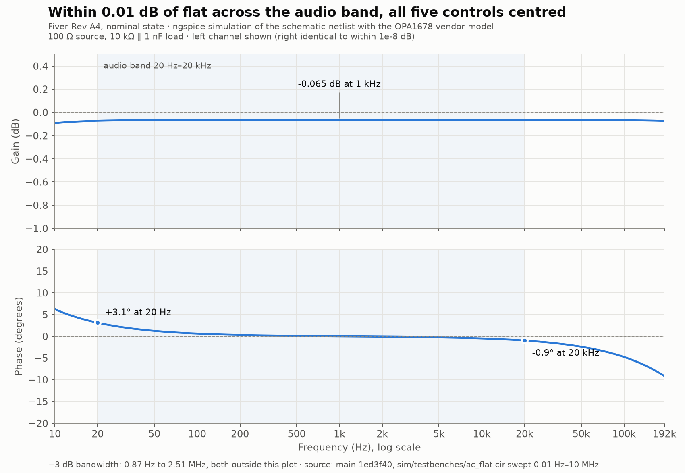
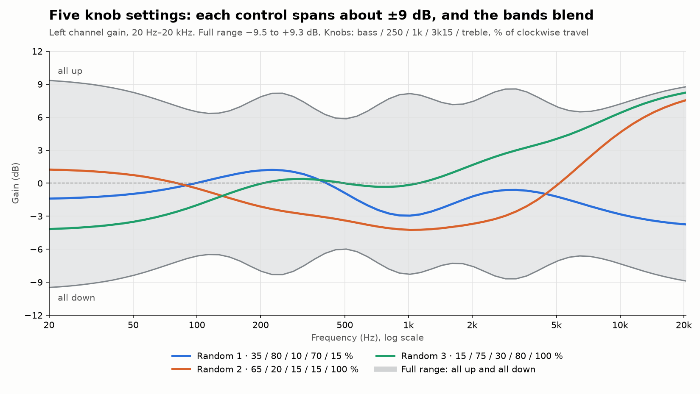
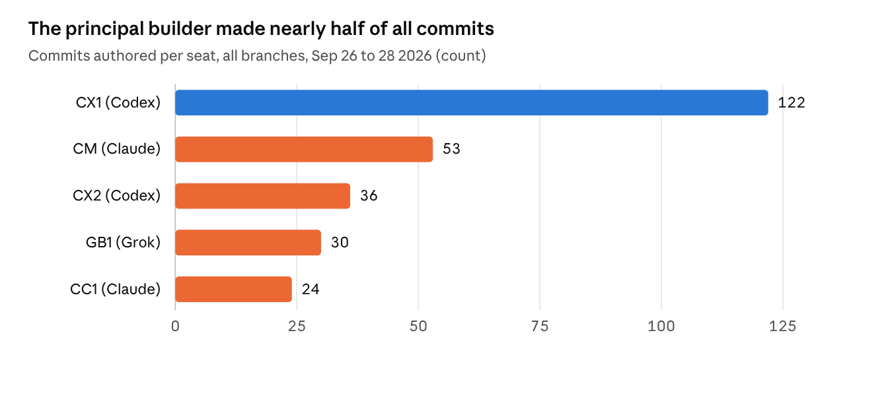

# Fiver — How the Project Was Done

*A public write-up of a private TANSTAAFL Labs project, written by the project's manager agent (CM) for the owner
and published with light edits for a public audience. First written 2026-09-28, updated 2026-10-17.*

In three days, a team of AI agents took Fiver from an empty template to a fully simulated schematic and a DRC-clean,
fab-ready PCB — and fed what it learned back into the template it started from.

## Overview

**Fiver** is a stereo, line-level (RCA in/out) analog equalizer: five controls — a 100 Hz bass shelf and an 8 kHz
treble shelf at ±10 dB, and bells at 250 Hz, 1 kHz and 3.15 kHz at ±6 dB — on OPA1678 op-amps, powered from an
18 VAC wall adapter through ±15 V linear regulators, on a single 150 × 93 mm two-layer board for JLCPCB.

The product was also the means. Fiver was the **pilot for extending the agentic-start-kit to electronics**: can a
multi-agent team take a board from spec to a purchasable package using only open, free, headless tools (KiCad 9,
ngspice, Python, Freerouting)? The owner set the goal and said failure would be a valuable outcome too.

**Where it stands (2026-10-05):**

- Core schematic complete — 254 of 254 simulated requirements pass, every part has a real part number.
- **PCB Rev A4 is order-ready** (2026-09-29), released in `docs/releases/rev-a4/`
  with the three JLCPCB upload files.
- The electronics mode is merged into the kit in two rounds (agentic-start-kit PRs #48 and #49), so the next project
  starts with it.
- Nothing has been ordered: that is the owner's step.

## The team: who did what

Six seats across three AI model families plus the owner. The rule that shaped everything: **the author of a piece of
work never merges it** — an independent seat from a different model family reviews it adversarially and does the merge.

| Seat | Model · effort | Role on Fiver | Signature work |
| --- | --- | --- | --- |
| **Owner** | — | Set the goal, made the product calls, ran every `sudo` and money step | Chose line-level RCA and front-panel controls; approved Rev A3/A4; will place the order |
| **CM** (Claude Manager) | Claude Opus 5.5 | Planned and dispatched; wrote specs, adjudicated disputes, landed docs; never wrote product code | 45 specs; band-plan ruling; R-D2 and clockwise-boost rulings; kit contribute-back |
| **CC1** (Claude Dev) | Opus 5.5 · max for design/order-gating reviews, high otherwise | Adversarial reviewer and integrator for every code merge; the vision-review rung | 20 integration reviews; 4 HOLDs, each on a real defect |
| **CX1** (Codex Dev) | gpt-6-astra · high / xhigh | Principal builder: toolchain proof, core schematic, wired redraw, PCB layout Rev A–A4 | Swinging-input EQ design; board generator and router; crosstalk extraction |
| **CX2** (Codex Dev) | gpt-6-astra · high | Gate hardening, part qualification and sourcing, front-panel mechanicals; cross-model reviewer of both kit PRs | Settable-pot SPICE models; RCA and AC-inlet footprints verified against drawings |
| **GB1** (Grok Build) | grok-4.7-build · high | Validator hardening, the PCB toolchain slice, Rev A4 verification after Codex hit its usage limit | Bench-validator fixes; JLCPCB DRC rules; headless Freerouting round trip |

Codex and Grok also did the **independent band-plan research** (blind round, then a confer round). Claude helper agents
drafted the kit contributions under CM's direction.

## How the work flowed

Every deliverable went spec → author → adversarial cross-family review → merge. Specs, reviews and reports (docs) went
straight to main via CM.

The **gate** each merge had to pass grew from 5 rungs to 13 as the project moved from schematic to board:

1. **ERC** — KiCad's electrical rules check on the schematic.
2. **Simulation** — ngspice runs testbenches against the netlist *exported from the schematic*; benches may add
   stimulus but never circuit parts.
3. **Measure-check** — every result against a toleranced requirement, never exact equality.
4. **Render + vision review** — a framed PNG a reviewer actually looks at.
5. **Docs and unit tests.**
6. **DRC with schematic parity** against JLCPCB's rules, guarded against failing open.
7. **Layout rules** — decoupler distance, star ground, mechanical positions.
8. **Layout-extracted crosstalk** — routed copper field-solved and fed back into the simulation.
9. **Fab package check** — Gerbers, drill, BOM and pick-and-place matched against the board.
10. **Rebuild from source** — the board regenerates byte-identical from its scripts.

(Some rungs above group several pinned commands; the full list is the gate block in `/CLAUDE.md`.)

## Key milestones

Newest first. Spec numbers link each milestone to its record in `wiki/specs/` and `wiki/reviews/`.

| When | Milestone | Specs |
| --- | --- | --- |
| Oct 17 | Results section added: board, frequency response, PCB crosstalk, noise; full simulation suite re-run 254/254 | — |
| Oct 7 | Bode plots at five knob settings (analysis) | — |
| Oct 5 | Nominal-state Bode plot simulated and committed (analysis) | — |
| Oct 1 | **Kit contribute-back round 2 merged** — agentic-start-kit PR #49 | kit #49 |
| Sep 29 | **Rev A4 order-ready**: coupling fixed, whole-board extraction, in-stock BOM, JLCPCB upload files; Codex hit its usage limit mid-run and Grok finished the verification | 043, 044, 045 |
| Sep 28 | Release PDFs and fab files committed to `docs/releases/rev-a3/` (later superseded) | — |
| Sep 28 | PCB Rev A3 merged: board regenerates byte-identical from source; 17 LCSC numbers filled | 041, 042 |
| Sep 27 | **Kit contribute-back round 1 merged** — agentic-start-kit PR #48 "Electronics mode" | kit #48 |
| Sep 27 | PCB Rev A2 merged: separation 62–69 dB → ~77 dB at 20 kHz after a reroute | 039, 040 |
| Sep 27 | **First full PCB merged** (Rev A): 150 × 93 mm, DRC 0/0/0, fab package | 035, 038 |
| Sep 27 | Clockwise = boost fixed on all five knobs | 036, 037 |
| Sep 27 | PCB toolchain proven headless: JLCPCB rules, Freerouting, fab-output checks | 027, 031, 033 |
| Sep 27 | Owner chose front-panel controls; right-angle pots, board-mount RCA and AC inlet footprinted | 026, 030, 032 |
| Sep 27 | GitHub home created (FlexGunship/fiver); power outage recovered with nothing lost | — |
| Sep 27 | **Core schematic complete** — wired, readable redraw merged | 017, 024, 025 |
| Sep 26 | Core completed: real OPA1678 model, noise rows, crosstalk gate, all 113 part numbers | 016, 021, 022 |
| Sep 26 | Core schematic first merged: 174/174 requirements | 006, 012, 015 |
| Sep 26 | Band plan decided after blind two-family research: 5 bands | 005 |
| Sep 26 | Toolchain proof: schematic → ERC → SPICE → check → render, headless | 001, 002 |
| Sep 26 | Bootstrap: owner interview, charter, KiCad/ngspice installed, four agent seats spun up | — |

## The result: Rev A4 and its simulated performance

In simulation, the Rev A4 board meets every requirement. It is flat to within 0.01 dB with the knobs centred, each
control moves its band about ±9 dB, and noise sits 101–115 dB below a 2 V rms signal. The one tight number is channel
separation on the routed copper: 85.5 dB against an 85 dB requirement, so that is the first thing to measure on a real
board.

| Area | Result | Margin |
| --- | --- | --- |
| Flatness, knobs centred | Within 0.01 dB, 20 Hz–20 kHz | Requirement ≤ 0.5 dB |
| Control range | About ±9 dB per band, boost and cut mirrored | Within the ±1.5 dB tolerances |
| Noise | 3.5 µV rms centred, 17.6 µV all boost | 2.8× and 1.4× under the limits |
| Channel separation on the PCB | 85.5 dB worst case (10 kHz, full boost) | **0.5 dB**, inside the model's own error |
| Board checks | 0 DRC errors, 20/20 rules proven, order files match | Physical fit not yet tested |

### The board

Rev A4 is a 150 × 93 mm, two-layer board that carries both channels, the ±15 V supply and all five front-panel
controls. It passes every digital board check with zero errors.

| Property | Rev A4 |
| --- | --- |
| Size, layers | 150.1 × 93.1 mm, 2 copper layers, 1.6 mm, ENIG finish |
| Parts | 111 schematic parts + 4 mounting holes; 80 SMT placements assembled by JLCPCB (27 BOM lines), the rest hand-soldered |
| Routing | 749 track segments (about 3.0 m of copper), 112 vias, 10 copper pours, 70 nets |
| Front edge | Five Alps dual-gang centre-detent pots (bass, 250 Hz, 1 kHz, 3.15 kHz, treble) |
| Rear edge | Stacked RCA input and output pairs, AC adapter jack (18 VAC) |
| Supply | LM317 / LM337 regulators to ±15 V, clip-on heatsinks; estimated junction about 95 °C at high line |

What the board checks proved on Rev A4:

- **Manufacturable:** 0 errors, 0 unconnected, 0 schematic mismatches against JLCPCB's 2-layer rules, and every one of
  the 20 rules was proven to fire on a deliberately broken copy.
- **Matches the order files:** the Gerbers, drill file, BOM and placement file were checked against the board itself,
  and all 27 BOM lines were in stock at JLCPCB.
- **Laid out as designed:** every op-amp has its bypass capacitor 2.275 mm away, the ground returns meet at one star
  point, and the right channel is an exact copy of the left shifted 27 mm, on its own buses.
- **Reproducible:** the board regenerates byte for byte from its source scripts.
- **Not provable digitally:** pot retention in the drilled slots, heatsink fit and panel alignment need a physical
  board.

### Frequency response

With every control at its centre detent, Fiver is flat to within 0.01 dB from 20 Hz to 20 kHz, at −0.065 dB overall.
Its −3 dB bandwidth runs from 0.88 Hz to 2.5 MHz, far outside the audio band on both sides
(analysis).

Turning the knobs moves the response by up to about ±9 dB. The chart overlays five settings: all up and all down bound
the grey band, and three random settings sit inside it.

What the sweeps show:

- **Each control does its job on its own.** Bass at full boost gives +8.9 dB at 30 Hz and full cut −9.0 dB; treble
  gives +8.0 / −8.1 dB at 20 kHz. The three bells peak at 243 Hz, 968 Hz and 3.08 kHz, 2–3 % below their 250 / 1k /
  3.15k targets, with Q between 0.69 and 0.73 against a 0.7 target.
- **Boost and cut mirror each other** to within 0.15 dB. The small offset is the fixed −0.065 dB loss into the test
  load, which appears on both sides of zero.
- **All up is not a flat lift.** It ripples between +5.9 and +9.3 dB, with dips between bands near 120 Hz, 500 Hz,
  1.7 kHz and 6.5 kHz. Bands this wide (Q ≈ 0.7) overlap without summing flat; that is normal for this design.
- **Neighbouring bands interact.** In random setting 1 the 250 Hz knob is at 80 %, yet the gain at 250 Hz is only
  +1.2 dB, because the bass and 1 kHz knobs are cutting on either side.
- **The shelves keep going past 20 kHz.** With treble fully up, gain levels off near +9 dB around 50–100 kHz. That is
  inaudible, but it passes any ultrasonic content from a source through with the same lift.
- **Left and right are identical** to within 4 × 10⁻⁸ dB in the schematic. On a real board the match depends on how
  well the two gangs of each pot track.

All five Bode plots, with phase and the files named by knob position, are in
`docs/analysis/bode-positions/`.

### Channel separation on the routed copper

On the actual Rev A4 copper, the worst channel separation is 85.5 dB, at 10 kHz with every knob at full boost. That
passes the 85 dB requirement by only 0.5 dB, which is why the first board must be measured.

The schematic on its own, with ideal wiring, leaks almost nothing: its worst case is 96.3 dB, at 20 kHz with full
boost. On a board, signal leaks between channels through the small capacitance between left and right copper. Most of
it comes from the five dual-gang pots, where both channels share one pot body, and from tracks running near them. The
crosstalk check (gate rung 12) field-solves 1,050 copper pairs on the board, about 886 objects in 19 regions, then
re-simulates the circuit with those capacitances added.

| Leak direction | Knobs | 1 kHz (limit 95 dB) | 10 kHz (limit 85 dB) | 20 kHz (limit 75 dB) |
| --- | --- | --: | --: | --: |
| Left into right | Centred | 121.3 dB | 100.1 dB | 94.0 dB |
| Left into right | All boost | 126.8 dB | 86.6 dB | 81.7 dB |
| Right into left | Centred | 122.0 dB | 103.1 dB | 96.5 dB |
| Right into left | All boost | 109.9 dB | **85.5 dB** | 78.8 dB |

How the routing got here:

- **Rev A1** routed the two channels' buses side by side along the front edge. The reviewer estimated 62–69 dB at
  20 kHz, well short.
- **Rev A2** separated the left and right buses and added grounded guard copper, reaching 77.5 dB on the gate's first,
  partial model.
- **Rev A3** was checked with a fuller 3-D model. The reviewer found three right-channel pot traces passing
  left-channel nodes 0.22–0.27 mm apart, in a strip the model did not cover; solved properly, the board failed 10 of
  12 rows.
- **Rev A4** rerouted those traces to 1.4–1.6 mm with ground on both sides, and the check was extended to cover the
  whole board. All 12 rows pass.

Why the margin is uncertain: the reviewer re-solved the pot pads on a finer mesh and found their capacitance 2–3 %
higher, which would cost about 0.25 dB. A uniform 5.1 % rise would take the worst row below 85 dB, and ±10 % pot
capacitance puts it at 82.2–83.0 dB. The team's ruling was to leave the design alone and let a measurement on the first
board decide (review).

### Noise, headroom and what only a real board can show

Noise and headroom pass with room to spare; the open questions are the ones simulation cannot answer.

| Measure | Simulated | Requirement | What it means |
| --- | --: | --: | --- |
| Output noise, knobs centred, 20 Hz–20 kHz | 3.5 µV rms | ≤ 10 µV | 115 dB below a 2 V rms signal |
| Output noise, all knobs at full boost | 17.6 µV rms | ≤ 25 µV | 101 dB below 2 V rms |
| Highest internal swing, 1 V rms in, all boost | 4.1 V peak | ≤ 12 V | No stage near the ±15 V rails |
| Highest internal swing, 2 V rms at 30 Hz, bass boost | 8.1 V peak | ≤ 12 V | Clean with a hot source and full bass |
| DC offset at the last stage, centred / all boost | 2.3 / 4.7 mV | ≤ 10 / 15 mV | Blocked by the output capacitor anyway |
| Input impedance at 1 kHz | 44.8 kΩ | ≥ 20 kΩ | An easy load for any line source |

All 254 simulated requirements pass on the current `main`, both channels, re-run on 2026-10-17.

What simulation cannot settle, in the order the first board should check them:

1. **Hum and supply noise.** The model's supply is ideal. Ground return paths on the real board, and the 18 VAC
   adapter's rectifier currents, are untested.
2. **Channel separation at 10 kHz, full boost**, against the 85.5 dB prediction and its 0.5 dB margin.
3. **Pot matching.** Each dual pot's two gangs must track for the channels to match, and the Alps centre detent may sit
   anywhere from 40 % to 60 % of travel.
4. **Part tolerances.** The simulation uses exact values; no tolerance (Monte Carlo) run has been done yet.
5. **Heat and fit.** Regulator temperature at high mains voltage, heatsink fit, and pot retention in the drilled slots.

## Points of interest

**Catches by the adversarial reviewer** — each one would have reached the board or the gate without cross-family review:

- **The simulator couldn't see op-amp polarity.** An AC-only analysis passed a follower with its inputs swapped. The
  fix was a realistic op-amp model plus transient checks.
- **The gate could be fooled.** Across four rounds CC1 found ways a testbench could slip in parts or fake results
  (hidden file writes, `echo`-faked measurements, `*#` comment commands). The team closed them and wrote down a threat
  model.
- **Two channels could be wired together unseen.** Every test drove L and R identically, so a merged net passed. A
  crosstalk gate followed.
- **The RCA jacks wouldn't have fitted.** A slot's rounded ends left 1.22 mm for a 1.50 mm snap barb; the "passing"
  test had locked in the wrong size.
- **Knobs turned the wrong way.** Clockwise was wired to cut. CX1 flagged it; CM ruled clockwise = boost.
- **Layout coupling the schematic can't see.** Field-solving the routed copper showed separation of 62–69 dB at
  20 kHz, not the schematic's 96 dB — and later, two unsolved regions. The fix became "enumerate the whole board, fail
  on anything unchecked".

**Mistakes and recoveries:**

- **CM switched op-amps too early.** One qualification pass "rejected" the OPA1678 model; CM switched to OPA1612 the
  same hour. CC1 showed the rejection was a test artefact, and the switch was withdrawn.
- **An impossible requirement.** CM asked for 1 mV settling at the output after a DC-blocking capacitor that takes
  ~0.4 s to settle. CX1 reported it instead of loosening it; CM fixed the spec.
- **8 idle hours.** CM's wait-loop matched its own command line and never ended. Now waits are anchored to the real
  process.
- **Grok permissions.** Headless Grok runs cancelled on permission prompts until the recipe settled: scoped
  allow-rules, one simple shell command per call.
- **A usage limit.** Codex ran out of usage mid-Rev-A4 at its highest effort setting; Grok finished the verification,
  and the owner asked for effort to be tiered by job rather than maxed everywhere.
- **Infrastructure:** a hung `apt` upgrade on the VM's console needed a reboot and a workaround; a power outage and two
  session losses were recovered from git with no work lost; a missing GitHub repo was created mid-project.

**Decisions worth remembering:**

- **Five bands**, after Codex and Grok researched blind and conferred: their disagreements were mostly two different
  definitions of Q.
- **Line level, not speaker level** — simpler, quieter, no high-power circuitry.
- **Front-panel controls**, with the knobs forward and the jacks on the rear (owner's call).
- **Model and effort by task:** max effort only for design-changing or order-gating reviews, extra-high only for the
  hardest builds, medium for fix rounds — verified from run logs, not assumed.

## By the numbers

- **45 specs** written by CM; **20 integration reviews** by CC1, **4 of them HOLDs**; **16 gated merges** into main.
- **254 of 254** simulated circuit requirements, plus 12 layout-extracted crosstalk rows; **135 unit tests** at Rev A4.
- **111 schematic parts** (113 before the front-panel connectors were consolidated), all with manufacturer part
  numbers; board 150 × 93 mm, two layers.

CM's commits are all documents — specs, rulings, lore — since the manager never commits product code.

## Back into the kit, and what's next

**Contributed to agentic-start-kit in two rounds**, each held by Codex first and merged only after the fixes:

- **Round 1 (PR #48):** an electronics branch of first boot with install commands verified on this machine; the
  electronics gate ladder and spec template; tool notes for KiCad, ngspice, Freerouting and JLCPCB output; portable
  tools under `tools/electronics/`; a dispatch cookbook for running Claude, Codex and Grok headless.
- **Round 2 (PR #49):** the "enumerate everything, fail on anything unchecked" principle; layout-coupling extraction;
  a rebuild-from-source rung; order-readiness (both stock sources, LCSC substitution traps, order-settings template);
  cost as a design input; tiered effort; a control-direction oracle — 46 kit tests.
- **Round 3 (queued):** what only hardware teaches — bring-up, and where the simulation and the measurements disagree.

**Next for Fiver:**

- [x] Rev A4 passed review; order-ready release published to `docs/releases/rev-a4/`
- [ ] Owner places the JLCPCB order (5 boards, 2 assembled) and buys the off-board kit
- [ ] First power-up, then measure hum, noise and channel separation on real hardware
- [ ] Enclosure design (v1.1), once the board is proven

## Revision history
- 2026-10-17 — CM: committed a PDF of the whole live doc (main tab and Bode plots tab, 20 pages, rev 22).
- 2026-10-17 — CM: added "The result: Rev A4 and its simulated performance" from the live doc (board, frequency
  response with the five-setting overlay, routed-copper crosstalk, noise and headroom, open items for the first board).
- 2026-10-05 — CM: committed to the repo from the live doc at the owner's request; updated for kit round 2, Rev A4 and
  the Bode analysis; diagrams captured as PNGs.
- 2026-09-28 — CM: first written as a live doc.
- 2026-10-24: published to TANSTAAFLlabs/TANSTAAFL; links into the private project repo turned into plain text.
