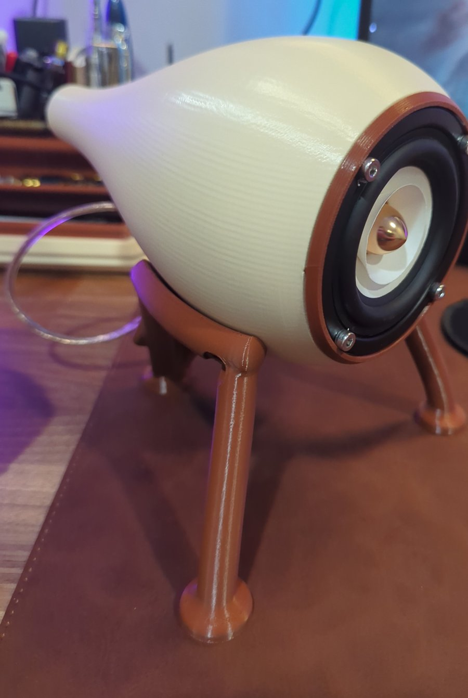
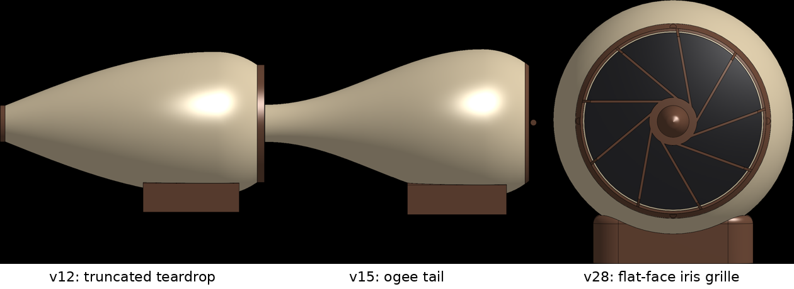
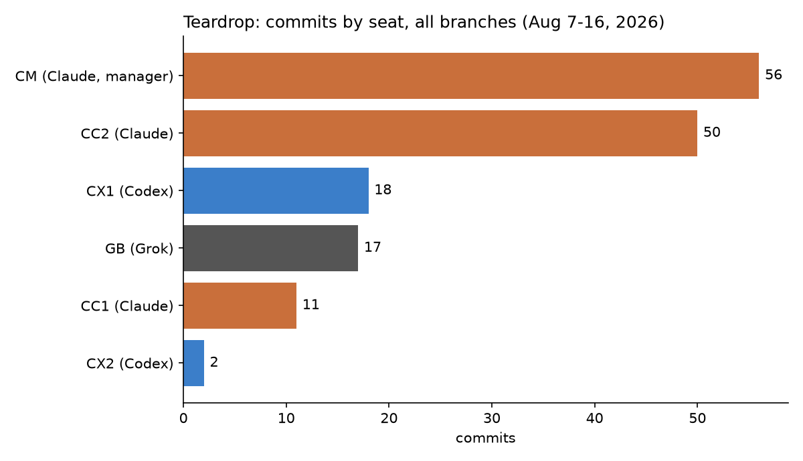
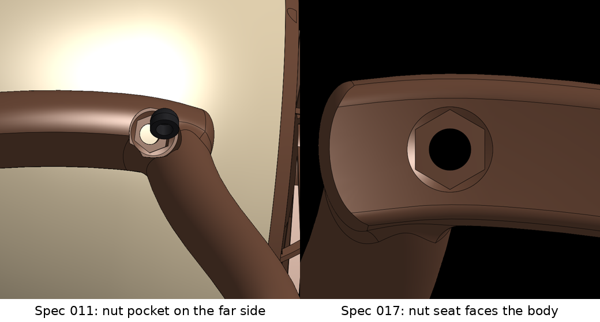
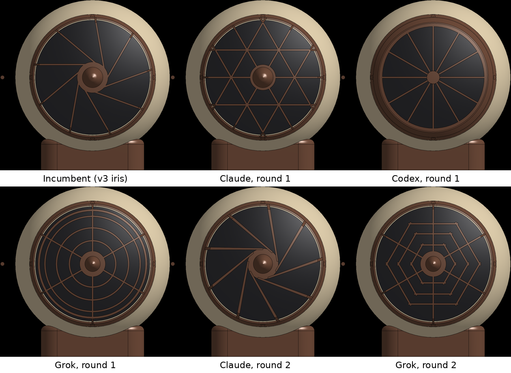
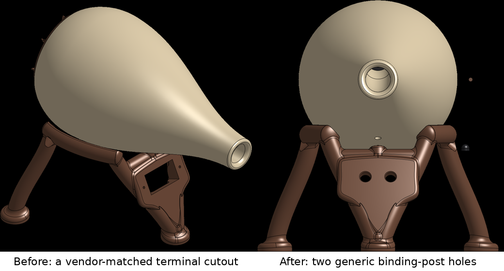

# Teardrop (Slipstream-II): How the Project Was Done

*A public write-up of a private TANSTAAFL Labs project, compiled from the project's own repository: specs, review
records, passdowns and git history. Covers August 7–16, 2026.*

In four working days, a team of AI agents from three model families took a 3D-printed desktop speaker that already
worked, gave it a one-piece tripod stand with a kinematic three-screw mount, ran a blind grille design contest, and put
a stereo pair on the owner's desk. Then the owner looked at a photo and found a bug that every automated check had
passed.

## Overview

**Slipstream-II** (project codename *Teardrop*) is a 3D-printed bass-reflex desktop loudspeaker with one full-range
driver per enclosure:

- **Enclosure:** a truncated teardrop (a sphere cut by the baffle plane) with a raised-cosine "ogee" tail. It's 210 mm
  long, with a Ø98 mm baffle, a Ø120 mm peak and a 4 mm wall. It's printed in PETG with no supports, in about 7 hours
  and 250 g per body.
- **Port:** an internal serpentine bass-reflex port, Ø19 × 135 mm. The tuning (about 84 Hz) and net volume (about
  0.81 L) are calculated, not measured.
- **Grille:** a "flat-face iris" of nine swirl chords and a spinner. It's 6.6 cm³ and prints in 42 minutes with no
  supports.
- **Stand:** a one-piece tripod that holds the body's axis 130 mm above the desk. The body touches the stand at exactly
  three points: soft TPU caps on three M4 screws, with ±2° of fine tilt trim (about 0.7° per screw turn). Coarse tilt is
  a print-time parameter. Tip-over margin is 29 mm at the worst tilt and trim.

The speaker was also a test. Teardrop was the **model project for physical-product engineering** on the agentic
operating model. The question was whether multi-agent development with cross-model adversarial review extends from
software to mechanical design, with git as the source of truth, the CAD kernel as the runtime, and fabrication as the
final gate.

One thing to know up front: **the enclosure predates the repository.** Version 1 (body, saddle stand and grille) was
designed in earlier sessions and had already been printed and played on August 6. On August 7 it was ported into a
repo built from the agentic-start-kit template. The agents' work described here is the **stand line, the grille
bake-off, the CAD toolchain guardrails, two local-CAD pilots and the documentation**.

**Where it stands (August 16):**

- A **stereo pair is assembled and in daily use.** Owner: "things sound good, they work well."
- Tripod stands are printed and in service, and `main` is green at 17 of 17 gate checks.
- **Publishing the design is blocked** on something the project never did: measure sound (see
  [The lesson that reframed the project](#the-lesson-that-reframed-the-project)).

## The team: who did what

Six AI seats plus the owner. The rules: **the author of a piece of work never merges it**, and the integrator comes
from a different model family and is told to try to reject it. "Landing it is what happens when you fail to."

| Seat | Model (as recorded) | Role on Teardrop | Signature work |
| --- | --- | --- | --- |
| **Owner** | n/a | Art director, and the only operator of the physical steps (print, calipers, listening) | Body and stand sketches; ruled the first terminal design "overfitted"; **found the load-path defect from a photo**; named the speaker; printed and assembled everything |
| **CM** (Claude Manager) | Claude Fable 5, then Opus 5 | Planned and dispatched work; wrote every spec, adjudication and passdown; never wrote CAD | 19 specs; the three-family adjudication; the model-tier policy; 6 kit PRs |
| **CC2** (Claude Dev) | Claude Fable 5 | **Principal builder of the whole stand line** | Specs 006 → 017; the derivation that survived blind checking by three families; the load-path fix and its new gate check |
| **CC1** (Claude Dev) | Claude Fable 5 | Grille designer; build123d pilot | "Vortex iris" grille, the bake-off's best scorer; a build123d port that matched the reference to 0.04% |
| **CX1** (Codex Dev) | Codex (model not recorded) | API guardrails; grille designer; blind verifier; FreeCAD pilot | Rate-limit guardrails with a local call ledger; FreeCAD pilot with a 3.5 s regen |
| **CX2** (Codex Dev) | Codex (model not recorded) | Cross-model integrator | **Rejected** a merge on a 0.38 cm³ byte-identity mismatch, then passed the corrected branch |
| **GB** (Grok Build) | Grok 4.5 | Integrator, blind verifier, auditor, researcher | Integrations 010 and 019; the **blind audit that independently found the load-path defect** |

Most of the Codex, Grok and CC1 work lives on preserved, unmerged branches: grille candidates, pilots and verification
lanes. That's why their counts on `main` alone are much lower.

## How the work flowed

Every deliverable went **spec → author on a feature branch → cross-family integrator → `--no-ff` merge**. Specs,
reports and lore went straight to `main` via CM. The integrator also had to reproduce the committed measurements
**byte for byte** from the live CAD document.

The **gate** had four rungs, each run separately:

1. **Regenerate.** Push the FeatureScript source to Onshape, and every feature must regenerate cleanly.
2. **Measure-check.** Kernel measurements are checked against toleranced requirement rows, which grew from 6 to 17:
   envelope, volumes, axis height, footprint, belly clearance, contact count, trim extremes, thread engagement,
   binding-post holes, and finally **S11, "captured-nut seat faces the body"**.
3. **Slice-check.** Slice in OrcaSlicer with supports **off**. The G-code must complete with no support features, and
   time and mass must be sane.
4. **Render review.** Fresh renders are reviewed by a vision-capable model, because "dimensionally green can be
   visually wrong."

These practices emerged along the way:

- **Staged dispatch** for heavy CAD:
  - **A:** derivation only, in offline Python;
  - **B:** implementation in small commits;
  - **C:** a live gate run.

  Stage A alone caught four spec amendments by math before any geometry existed.
- **Blind multi-family verification:** other families recompute a derivation without seeing the original, and the
  manager adjudicates.
- **Metered-API budgeting:** the free Onshape tier allows 2,500 API calls a year. The first two days burned about a
  third of that, so every report logs its spend, and two **local-CAD pilots** (FreeCAD and build123d) tested an offline
  alternative.
- **Owner edits as design input:** when the owner tweaked the live CAD by hand, the team detected it, measured it, got
  a ruling, and ported it into the parametric source.

## Key milestones

| When (2026) | Milestone | Specs |
| --- | --- | --- |
| Aug 7 | Repo created from the kit template. Model project ported in with a 6/6 gate baseline | — |
| Aug 7 | **Full roster online in about 15 minutes**: five seats onboarded in parallel, all gate proofs green | 001–005 |
| Aug 7 | **Grille bake-off**, two blind rounds across three families | — |
| Aug 8 | Owner tabled the bake-off and simplified the stand brief (no adjustability, tilt as a print-time parameter). First one-piece tripod built gate-green | 006, 008 |
| Aug 8 | Onshape rate limits killed two dispatches, which led to the API guardrails. **First cross-family integration** | 009, 010 |
| Aug 9 | Three-family blind adjudication of the mount derivation. Kinematic three-screw mount built, 13/13 | 011 |
| Aug 9 | **Integration rejected** on byte-identity, then traced to an owner edit, kept and merged | 012 |
| Aug 9 | Feet and terminal provisions; twin local-CAD pilots and a face-off | 013–015 |
| **Aug 10** | **Stereo pair assembled; first tripod printed** | — |
| Aug 10 | Owner spots the wrong-side nut pocket from a photo. Blind audit confirms it; the fix lands with a new gate check | 016–019 |
| Aug 10 | Design signed off ("stand looks good now") and named Slipstream-II | — |
| Aug 12–13 | Lessons harvest; kit PRs merged; closing passdown | — |
| Aug 16 | Publication lane opened; acoustic measurement promoted to blocker | — |

## Points of interest

### The defect every check passed

Spec 011 put each captured nut on the **far side** of its boss from the load. The speaker's weight pushed the nuts
*away* from their bearing faces, so each joint was held only by thread friction.

That geometry passed:

- the full four-rung gate at five tilt-and-trim poses;
- 13, then 16, toleranced requirement rows;
- a three-family blind verification of the derivation;
- a cross-family adversarial integration with byte-identity;
- several of the owner's render reviews.

The owner caught it by looking at a photo of the printed part: *"did you put the hex pocket on the wrong side?"*

Then the process did something right. Grok was given a **blind audit** with no access to the fix or the discussion, and
reached the same conclusion from the geometry alone: "service support therefore reduces to preload / thread friction".
CC2's fix moved the hex pocket to the body side with zero fix cycles. A new requirement row, **S11**, reads 0 mm
(fail) on the old geometry and 3.29 mm on the new, so the gate can now see what it missed.

The defect was latent, not a failure: the first stand, printed from the old geometry, carried the speaker fine. The
written assembly guide had errors too. It reversed the load path in prose, misquoted a screw protrusion by 2 mm, and
**recommended washers that the stand's own travel math forbids**. The owner had already bought them.

### The grille bake-off

Three model families designed grilles blind from the same brief, in two rounds. Round 2 added a hard rule: easy to
print. Both round-2 survivors beat the incumbent on volume and mass, and one Codex candidate failed to regenerate in
CAD. The owner's verdict: *"the incumbent is still best, but seemed basically unprintable. Table this for now."* All
candidates are preserved on branches.

### "An example part is a class pointer, not a drawing"

The owner gave one binding-post terminal as an *example*, and the spec copied that one vendor part's exact cutout and
screw pattern. The owner ruled it overfitted, and the provision became two generic Ø8 mm holes at the 19.05 mm
dual-banana spacing.

### Mistakes and recoveries

- **An integration rejection that wasn't an author bug.** The Codex integrator rejected a branch on a 0.38 cm³
  mismatch. Offline forensics showed the owner had added a fillet in the CAD UI after the branch shipped. The owner kept
  the fillet ("adds to the soft organic flow"), it was ported into the parametric source, and the re-run passed. Lesson:
  ask for exclusive access during gate runs.
- **Blind verification that disagreed.** One verifier modeled the wrong tip-over pivot and stacked both nuts on one
  side. The other agreed with the author. The manager adjudicated, at zero CAD-API cost.
- **The model-tier leak.** For three days, every dispatch silently ran on the flagship model, because the manager never
  passed a model flag. The kit's own rule forbade it. The fix was structural: a required "tier" field in every spec.
- **Output-ceiling deaths.** Two dispatches died trying to do a whole derivation in one response, which led to the
  staged A/B/C pattern.
- **A printer freeze** killed a body reprint at 93%. Fixed with a firmware update, and a power-cycle before each print
  is now routine.
- **Stand #1 was printed ahead of `main`**, so two identical-looking stands couldn't be told apart in photos. Lesson:
  stamp physical parts with their revision.

### The lesson that reframed the project

> A loudspeaker had 17 gate rows, and not one of them measured sound.

Every requirement was geometric. The driver's model isn't even recorded; the port tuning and box volume are calculated,
not measured. When the owner decided to publish the design, the team ruled that only *speaker-intrinsic* correction
could ship: a passive baffle-step and Zobel network. The owner's room-specific EQ would harm other builders. That
network needs the driver's real impedance and the box's measured response. So the project's first acoustic
measurement became its blocker, and its biggest lesson: **audit the gate against the product's purpose, not just its
artifacts.**

## By the numbers

- **19 specs**, all by the manager. **3 integrations** landing 4 branches. **1 rejection** (the owner-edit mismatch).
  **2 blind lanes:** one derivation check with 2 verifiers, and one audit that found the real defect.
- **Gate rows: 6 → 17.** Stand volume grew from 88.8 to 98.5 cm³ across six revisions.
- **128 commits on `main`** (166 across all branches), about 4 active build days.
- **Local CAD pilots:** FreeCAD within 0.039% of the Onshape reference, build123d within 0.036%. Neither uses the
  metered API.
- **Print:** stand 9 h 24 min / 118 g; body about 7 h / 250 g; grille 42 min / 9 g; trim caps under 2 minutes each.

## Back into the kit, and what's next

**Six pull requests to agentic-start-kit (#20–#25), all merged:**

- metered-API doctrine and budgeting;
- dispatch survivability;
- blind verification lanes;
- byte-identity integrations;
- per-dispatch model tiering with a forcing function;
- "a geometry oracle cannot see statics";
- audit the gate against its purpose;
- tag every figure by provenance (kernel-measured, stored parameter, slicer estimate, unverified);
- stamp physical articles with their revision;
- working with the owner (class pointers, queue discipline, declined options recorded as declined).

**Next for Slipstream-II:**

- [x] Stereo pair assembled and in use; stands printed; design signed off
- [ ] Measure the acoustics: an impedance sweep and the in-box response
- [ ] Identify and document the driver
- [ ] Design the passive baffle-step and Zobel network, plus a component shelf in the enclosure, then publish
- [ ] Decide whether build123d becomes the offline pre-flight CAD oracle

## Lessons worth keeping

1. A geometry oracle cannot see statics.
2. Scope verification to *failure modes*, not artifacts: "parallel verification of the wrong question is expensive
   agreement."
3. A confident prose explanation is an unchecked claim.
4. Keep a human looking at the actual artifact.
5. Celebration is a risk window: the defect was printed and documented on the project's best day.
6. A rule that needs an action needs a forcing function.
7. Conversational advice becomes de facto design.
8. Audit the gate against the purpose.

## Revision history

- 2026-10-24: first public version, compiled from the project repository.
